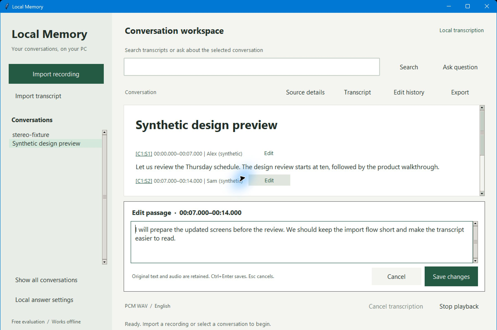

# Local Memory

Free early evaluation for Windows x64: import existing SRT/VTT transcripts, or transcribe English WAV, MP3 and M4A recordings on your CPU. Search and correct transcripts, then export Markdown. No cloud account or subscription is needed for those functions.

[Download the evaluation and read its limits](https://github.com/Results-First/local-memory-windows-validation/releases/tag/subtitles-cca464ed)

The updated workspace includes passage-level Edit controls and a multiline editor with Save/Cancel. Playback includes surrounding audio instead of cutting exactly at estimated speech timestamps. This remains an early evaluation.

Supports mono/stereo MP3, M4A (AAC/ALAC) and 16-bit PCM WAV. Both the input and decoded audio must fit within 256 MiB. Transcript import accepts UTF-8 SRT/VTT up to 32 MiB and JSON with timed start/end/text/speaker segments. Subtitle import runs no speech model and provides no audio playback. It preserves repeated/numeric captions, multiline text and overlaps. Malformed cues reject the entire file. Segmented VTT timestamp maps and SRT positioning suffixes are unsupported. The English speech model is included. Medium, Workbench, Python and cloud accounts are not required. Optional generated answers require a separately installed local model server. No microphone/system-audio capture, batch/video import, speaker recognition or wearable pairing is included. MP3/M4A uses Windows Media Foundation; Windows N editions need Microsoft's Media Feature Pack. No FFmpeg installation is needed. Compressed audio is retained as decoded PCM, not its original compressed bytes. Keep your original files.

Recordings and transcripts are retained in a local, unencrypted library. See the release listing for storage details, evaluation terms and SHA256. Free personal/internal-business evaluation has no activation or expiry. This edition remains free.

## Verification

The SRT/VTT update is checked by four [hosted Windows Server 2022/2025 jobs](https://github.com/Results-First/local-memory-windows-validation/actions/runs/38766862680), covering subtitle import/search/correction/export and MP3/M4A transcription with Python/FFmpeg absent from PATH. Subtitle fixtures cover repeated and numeric captions, overlaps, multiline Unicode text, original preservation, duplicate imports, restart persistence and atomic rejection of malformed files. Native dialogs are mocked. Local tests also cover ALAC, mono/stereo, Unicode paths, embedded cover art, cancellation, size limits and malformed/truncated fixtures. Local checks cover passage editing, correction history, search/export, original preservation and playback-buffer boundaries. The packaged editor was also exercised with real Windows input. In six public human-speech samples, buffered clips retained all six reference ending words in a supplementary recognition check, versus four with exact timestamp cuts. This is not a guarantee for all recordings or audio devices. First-run warnings and bare consumer Windows compatibility are not fully verified.

This repository contains test infrastructure, not application source. The standard hosted Windows tests use synthetic audio and retain receipts in workflow logs. No artifact/cache storage is requested.

